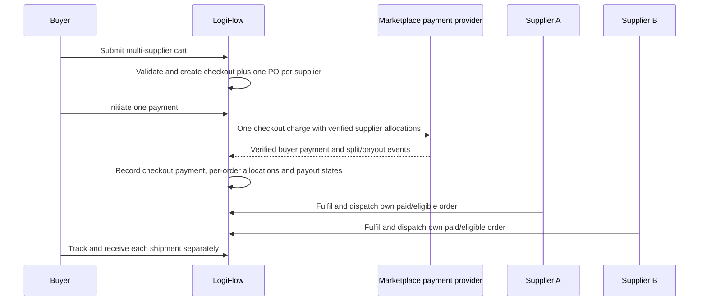

# Centralized Checkout Implementation Report

Date: 2026-11-17

## Current architecture

The backend has supplier-specific `PurchaseOrder` rows, each tied to one buyer organization and one supplier organization, with child `PurchaseOrderItem` and `PurchaseOrderSettlement` rows. The existing Daraja flow creates one pending settlement for one purchase order, validates callback correlation and queries Daraja before marking it settled. Shipment creation checks that individual purchase order settlement and receipt posts accepted stock into the destination distributor warehouse. The customer order payment model (`Payment`) is independently tied to one customer `Order` and has a uniqueness constraint on `order_id`.

## Marketplace persistence foundation added

Migration `V55__marketplace_checkout_financial_foundation.sql` adds `checkouts`, `checkout_items`, `checkout_payments`, `payment_allocations`, and `supplier_settlements`. A PO can optionally reference a checkout while retaining its single supplier. Checkout payment is modeled separately from the existing `Payment` entity to avoid changing the working customer-order Daraja flow or its constraints. Allocation records capture gross, provider fee, commission and supplier net; settlement is separately recorded per supplier. Checkout and settlement state enums are added. Checkout item fields hold product/supplier display snapshots, quantity, price, currency and optional destination warehouse.

The backend now implements the checkout orchestration in `CentralizedCheckoutService` and exposes it through `CheckoutController`. Checkout creation validates distributor ownership, an active destination warehouse per supplier, supplier stock ownership, published/active stock, distributor authorization, minimum order quantities, availability and prices through `PurchaseOrderService`. It creates one approved PO per supplier, reserves stock transactionally, links the POs to a checkout and stores checkout-item display and price snapshots. Checkout creation is idempotent per buyer organization and idempotency key. Checkout reads, payment initiation, cancellation, callback processing, allocations and supplier settlement records are also wired.

These APIs currently implement a centralized charge and internal allocation records, not provider-managed split settlement or supplier payouts. Successful buyer payment leaves supplier settlement records `PENDING`; the existing shipment path still relies on its purchase-order settlement rules. Checkout item snapshots are application-level records, not database-enforced immutability. The `logiflow.marketplace-checkout.enabled` property defaults to false and must be explicitly enabled for rollout.

## Provider capability assessment

Verified repository configuration and code show one Daraja STK Push integration using a single global shortcode, passkey and callback secret. Callback processing reconciles through Daraja and verifies one purchase-order settlement. That implementation does not perform marketplace split settlement, route by supplier, issue supplier payouts, report payout status, or manage supplier refunds/chargebacks. The repository contains no card provider checkout, webhook, or status verification integration. A card enum value is not a card integration.

Therefore this backend cannot currently verify that one M-Pesa or card transaction will split funds across multiple suppliers. No provider has been selected or newly introduced here. Do not interpret the persistence tables as operational payouts or mark a supplier paid when the buyer payment succeeds.

## API status

Marketplace endpoints are available under `/api/v1/checkouts`: create a multi-supplier checkout with `POST` and an `Idempotency-Key`, read buyer history/detail, initiate checkout payment, read payment/allocations, and cancel an unpaid checkout. Each `supplierOrders` entry requires `supplierOrganizationId`, `destinationWarehouseId`, and item lines containing `stockItemId` and positive `quantity`; `distributorOfferId` is optional. This matches the distributor cart payload described in the frontend implementation report. The existing per-purchase-order routes remain available and are unchanged.

## Configuration and settlement policy

`logiflow.marketplace-checkout.enabled` / `LOGIFLOW_MARKETPLACE_CHECKOUT_ENABLED` defaults to false. The observed `PAYMENT_NOT_CONFIGURED` response with message `Marketplace checkout is disabled` means this flag is false in the running Render service. Set `LOGIFLOW_MARKETPLACE_CHECKOUT_ENABLED=true` in that service's environment and redeploy to allow checkout creation. This enables the marketplace checkout API; it does not configure a payment provider or implement supplier split payouts.

Checkout payment supports Daraja sandbox via `MPESA_SANDBOX` / `MPESA` when the existing Daraja credentials and callback settings are configured. Simulated methods `DEMO`, `DEMO_MPESA`, and `DEMO_CARD` are explicitly non-production, require `LOGIFLOW_DEMO_PAYMENTS_ENABLED=true` plus the buyer organization's UUID in `LOGIFLOW_DEMO_ORGANIZATION_IDS`, and are rejected in production profiles. Demo methods do not transfer money. Successful checkout payments create allocation and pending settlement records only; they do not prove or perform supplier payout. Keep supplier settlement records `PENDING` until an approved provider or payout system confirms payout independently. No internal wallet or platform-held supplier funds have been added.

## Tests and execution

Ran `mvn -s target/maven-settings.xml -Dtest=PurchaseOrderServiceTest,PaymentServiceTest,PurchaseOrderShipmentServiceTest test`: BUILD SUCCESS, 16 tests run, 0 failures, 0 errors, 0 skipped. Maven downloaded dependencies into the workspace-local `target/maven-repo`. Compilation included the new entity classes. These are regression tests for the existing per-order flows; no marketplace checkout orchestration tests exist because no orchestration is wired. The V55 migration was not applied to a database; validate it in a disposable PostgreSQL database before rollout.
## Required decisions before operational implementation

1. Select and contract an approved marketplace-capable provider. Confirm in writing its Kenya availability, KES, STK Push, hosted card, subaccounts/beneficiaries, split rules, fees, payout timing, callbacks/reconciliation, refunds and chargebacks.
2. Determine whether the provider performs split settlement directly and how each supplier completes merchant/KYC onboarding.
3. Define buyer roles/identity for distributor and future customer checkout, per-supplier destination capture, cancellation/stock-release rules, commission policy, and fulfilment policy while payouts are pending or failed.
4. Implement checkout APIs and provider adapter only after these payment and legal/compliance arrangements are approved. Then add integration tests with provider sandbox accounts and end-to-end payout evidence.

## Intended sequence after provider approval

